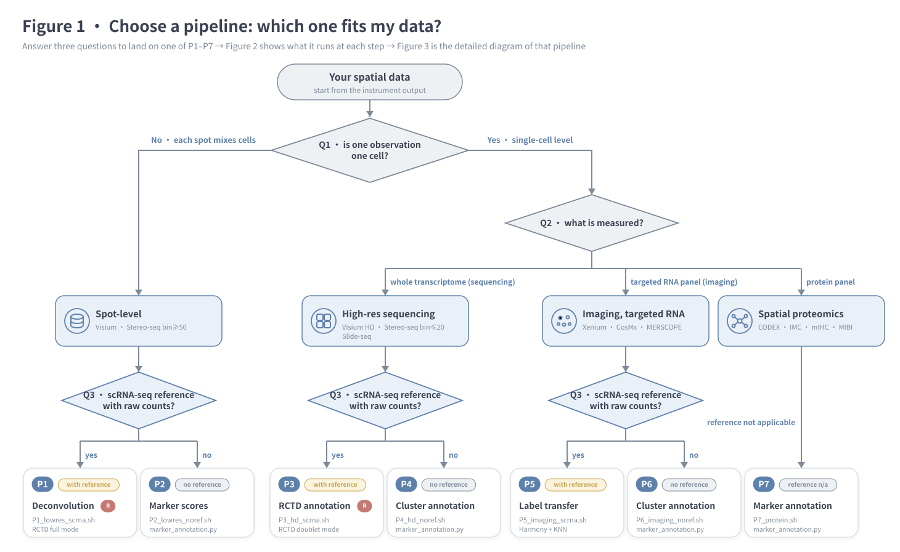
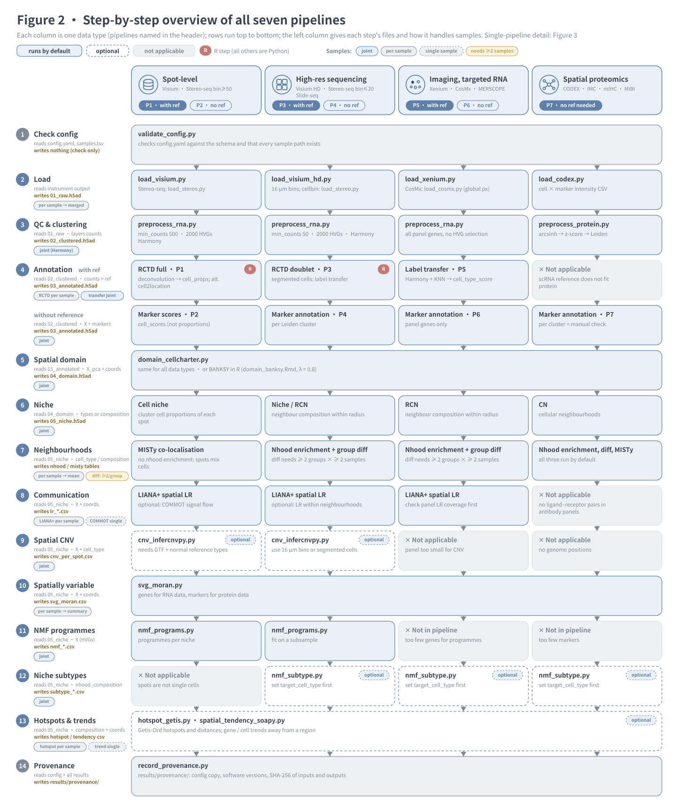
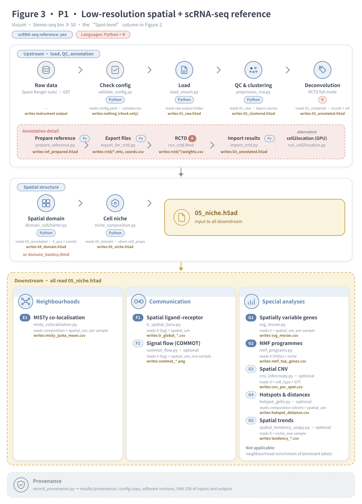
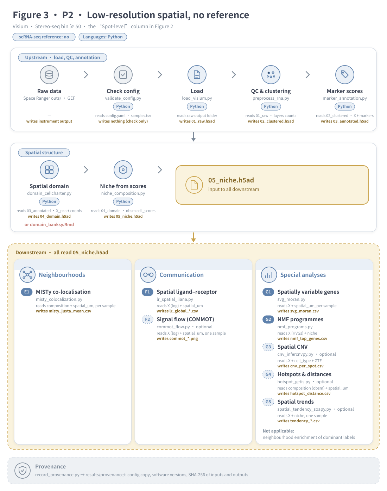
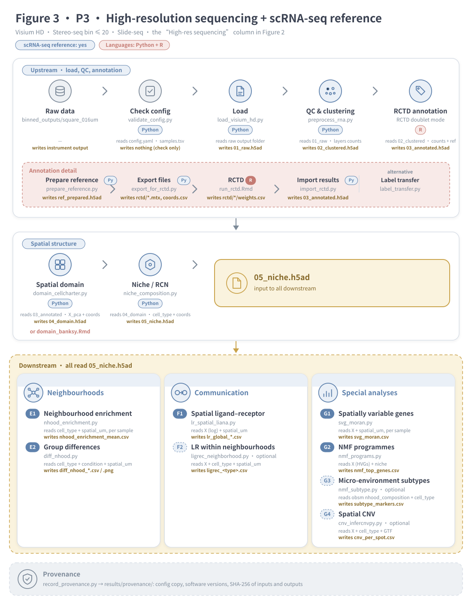
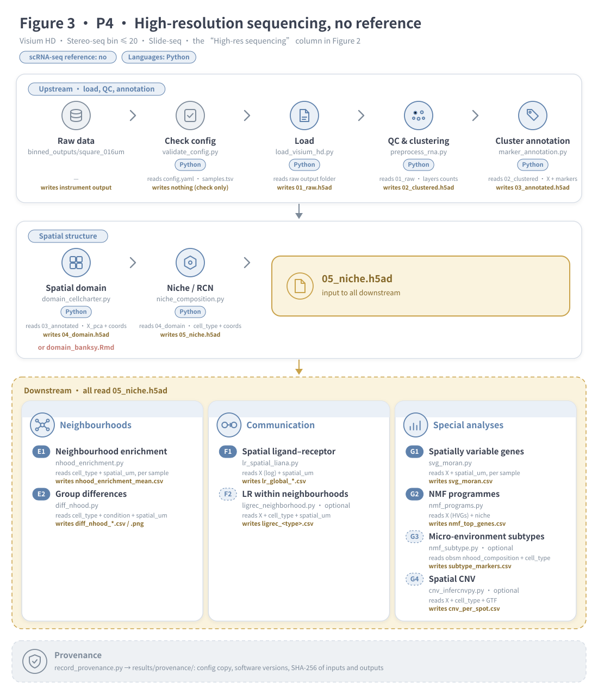
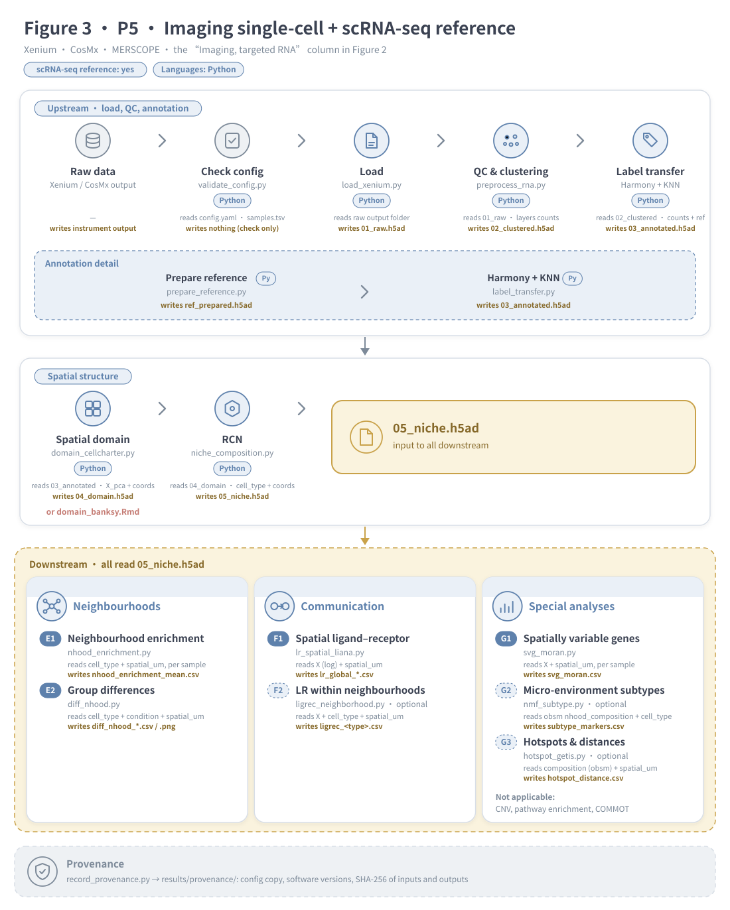
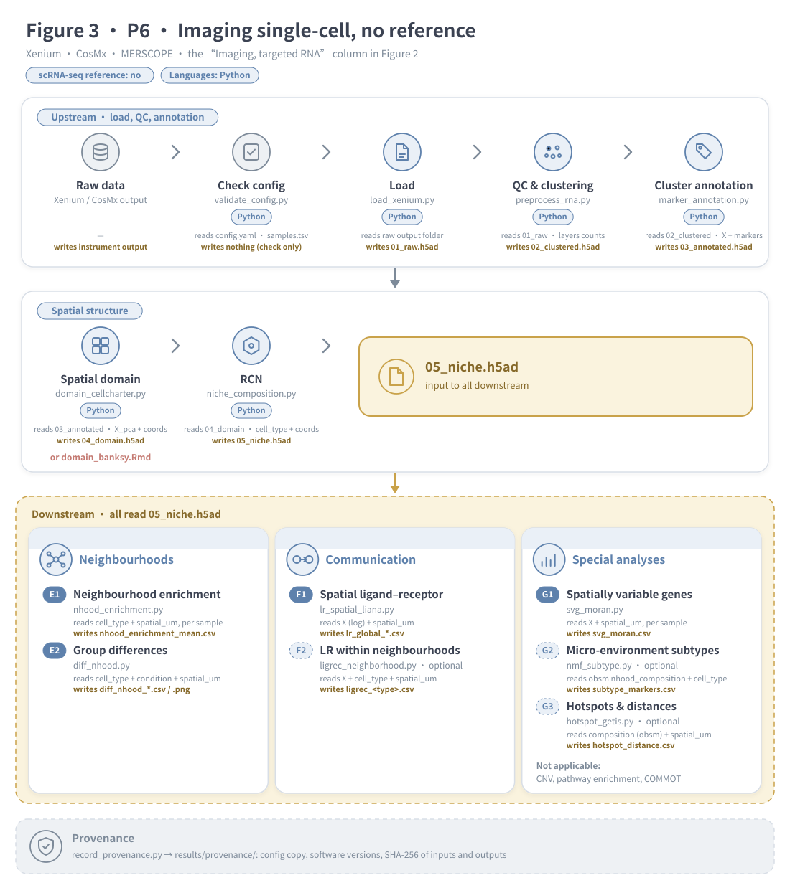
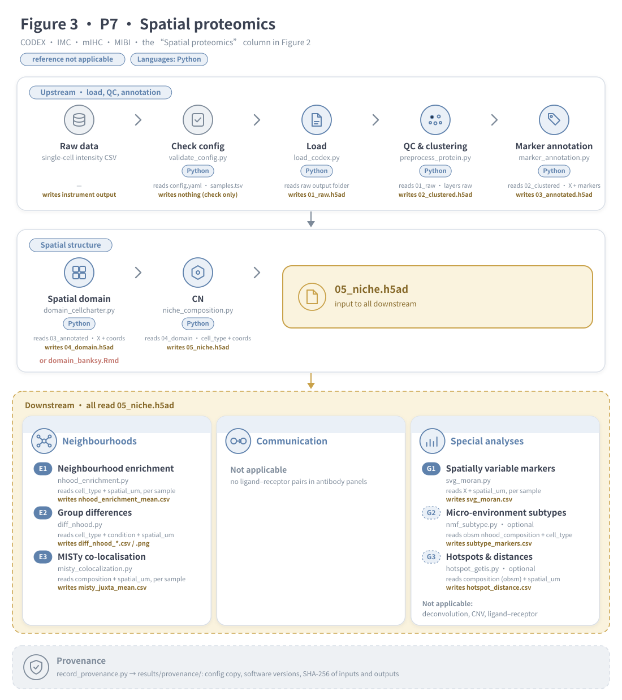
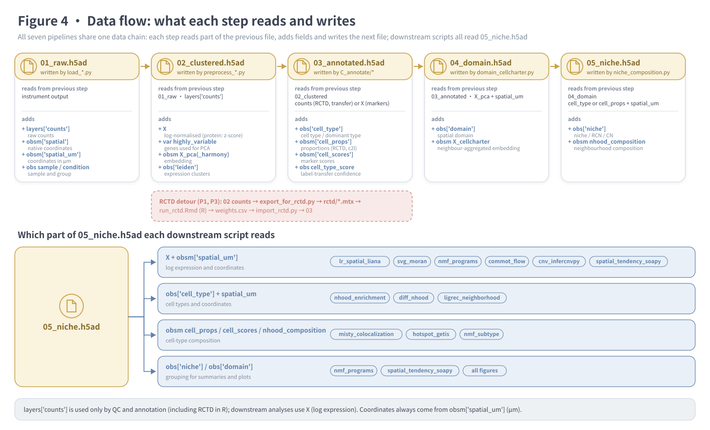

# spatial-downstream

**Clear, practical downstream pipelines for spatial transcriptomics and spatial proteomics: which method to use at each step, in Python or R, which analyses can pool samples and which must stay within one sample.**

[中文版 README](README.zh-CN.md) · Version 1.0.0 · License: MIT · Languages: Python + R

Keywords: spatial transcriptomics, spatial proteomics, Visium, Visium HD, Stereo-seq, Slide-seq, Xenium, CosMx, MERSCOPE, CODEX, IMC, deconvolution, RCTD, cell2location, label transfer, spatial domain, BANKSY, CellCharter, cell niche, cellular neighbourhood, neighbourhood enrichment, MISTy, ligand–receptor, LIANA+, COMMOT, spatial CNV, scanpy, squidpy, FAIR.

---

## 1. Why this skill exists

Downstream spatial analysis has two recurring sources of confusion:

1. **Too many tools, split between R and Python.** For one task there are often five candidates (RCTD or cell2location? BANKSY or CellCharter? squidpy, LIANA+, COMMOT or CellChat?), some only in R and some only in Python, and it is not obvious which one suits your platform or how to pass data between the two languages.
2. **Unclear which analyses can pool samples.** Some steps can put all samples into one model; others are only meaningful within one tissue section. Mixing them up does not raise an error; it silently produces wrong neighbourhoods.

This skill turns that into **clear, practical pipelines**:

- **One pipeline per situation.** Seven pipelines (P1–P7) cover data type × whether a scRNA-seq reference is available. Figure 1 picks the pipeline from three questions.
- **One recommended method per step**, with the language stated (Python or R). Each R step comes with a tested file-based bridge back to Python, so you do not have to choose between two ecosystems.
- **Inputs and outputs for every step.** Figures 2–4 show what each step reads from the previous one and what it writes.
- **Multi-sample or single-sample, with the reason.** Every step is marked as run jointly on all samples, run per sample, single-sample only, or requiring several samples (see “Multi-sample or single-sample?” below).
- **Runnable and tested.** Short readable scripts, pinned environments, provenance records, and end-to-end tests on simulated data in each platform's real file format.

Technically: every step is a short, top-to-bottom script (`# %%` cells, runnable in Jupyter / VS Code or as `python script.py`), steps exchange data through a documented AnnData contract, and `SKILL.md` tells the Claude Code assistant how to choose and adapt a pipeline.

## 2. Choose a pipeline

The documentation has three figures, from coarse to fine:

| Figure | File | Question it answers |
|---|---|---|
| **Figure 1** · choose a pipeline | `docs/decision_en.svg` | Which of P1–P7 fits my data? |
| **Figure 2** · step-by-step overview | `docs/steps_en.svg` | For each data type, what runs at every step? (all seven pipelines in one chart) |
| **Figure 3** · single-pipeline diagram | `docs/P1_en.svg` … `docs/P7_en.svg` | How does the chosen pipeline run, script by script? What does each step read and write? |
| **Figure 4** · data flow | `docs/dataflow_en.svg` | Which part of the previous file does each step use, and which fields does it add? (shared by all pipelines) |

Read them in that order: pick a pipeline in Figure 1, find its column in Figure 2, then open its Figure 3 and follow it. Figure 4 explains the files that connect the steps.

**Figure 1 · choose a pipeline** (answer the three questions from top to bottom):



| ID | Data type | Platforms | scRNA-seq reference | Annotation | Languages |
|---|---|---|---|---|---|
| **P1** `P1_lowres_scrna` | spot-level (several cells per spot) | Visium, Stereo-seq bin ≥ 50 | yes | RCTD *full* (or cell2location) | Python + R (RCTD step) |
| **P2** `P2_lowres_noref` | spot-level | Visium, Stereo-seq bin ≥ 50 | no | marker scores | Python |
| **P3** `P3_hd_scrna` | near single-cell, sequencing-based | Visium HD 8/16 µm, Stereo-seq bin ≤ 20 / cellbin, Slide-seq | yes | RCTD *doublet* | Python + R (RCTD step) |
| **P4** `P4_hd_noref` | near single-cell, sequencing-based | as P3 | no | marker scores per cluster | Python |
| **P5** `P5_imaging_scrna` | single-cell, targeted gene panel | Xenium, CosMx, MERSCOPE | yes | Harmony + KNN label transfer | Python |
| **P6** `P6_imaging_noref` | single-cell, targeted gene panel | as P5 | no | marker scores per cluster | Python |
| **P7** `P7_protein` | single-cell, protein panel | CODEX/PhenoCycler, IMC, mIHC, MIBI | not applicable | marker scores + manual check | Python |

Decision rules, in order:
1. Is one observation one cell? No → P1/P2. Yes → P3–P7.
2. Is it sequencing-based whole transcriptome (P3/P4), a targeted RNA panel (P5/P6) or protein (P7)?
3. Do you have a matched or same-tissue scRNA-seq reference with raw counts? Yes → odd-numbered pipeline; no → even-numbered.

Details and caveats per scenario: [`references/decision_guide.md`](references/decision_guide.md).

## 3. What each pipeline runs

**Figure 2 · step-by-step overview of all seven pipelines** (columns = data types, rows = steps in run order; solid = default, dashed = optional, grey = not applicable with the reason, red “R” badge = R step):



The same information as a table:

| Module | Step (script) | P1 | P2 | P3 | P4 | P5 | P6 | P7 | Language |
|---|---|---|---|---|---|---|---|---|---|
| Z | `validate_config.py` | ● | ● | ● | ● | ● | ● | ● | Py |
| A | `load_visium` / `load_visium_hd` / `load_stereo` / `load_xenium` / `load_cosmx` / `load_codex` | ● | ● | ● | ● | ● | ● | ● | Py |
| B | `preprocess_rna.py` (`preprocess_protein.py` for P7) | ● | ● | ● | ● | ● | ● | ● | Py |
| C | `prepare_reference` → `export_for_rctd` → **`run_rctd.Rmd`** → `import_rctd` | ● | | ● | | | | | Py → **R** → Py |
| C | `label_transfer.py` | | | | | ● | | | Py |
| C | `marker_annotation.py` | | ● | | ● | | ● | ● | Py |
| D | `domain_cellcharter.py` (or **`domain_banksy.Rmd`**) | ● | ● | ● | ● | ● | ● | ● | Py (or R) |
| D | `niche_composition.py` (niche / RCN / CN) | ● | ● | ● | ● | ● | ● | ● | Py |
| E | `misty_colocalization.py` | ● | ● | | | | | ● | Py |
| E | `nhood_enrichment.py` | | | ● | ● | ● | ● | ● | Py |
| E | `diff_nhood.py` (≥ 2 groups × ≥ 2 samples) | | | ● | ● | ● | ● | ● | Py |
| F | `lr_spatial_liana.py` | ● | ● | ● | ● | ● | ● | | Py |
| F | `ligrec_neighborhood.py`, `commot_flow.py` | opt | opt | opt | opt | opt | opt | | Py |
| G | `svg_moran.py` | ● | ● | ● | ● | ● | ● | ● | Py |
| G | `nmf_programs.py` | ● | ● | ● | ● | | | | Py |
| G | `cnv_infercnvpy.py`, `hotspot_getis.py`, `nmf_subtype.py`, `spatial_tendency_soapy.py` | opt | opt | opt | opt | opt | opt | opt | Py |
| Z | `record_provenance.py` | ● | ● | ● | ● | ● | ● | ● | Py |

● runs by default · opt = commented out in the pipeline; enable after setting its parameters.

### Figure 3 · single-pipeline diagrams

Click a pipeline to open its detailed diagram (each one corresponds to one column of Figure 2). Under every step, “reads” is the part of the previous file it uses and “writes” is the file it produces. Solid step badges run by default; dashed badges are optional. Colours: blue = Python steps, red = R steps, yellow = key output / scRNA-seq reference available, grey = neutral (config, provenance, not applicable). Regenerate the figures with `python docs/make_figures.py`.

<details><summary><b>P1</b> · Low-resolution + scRNA-seq reference</summary>



</details>

<details><summary><b>P2</b> · Low-resolution, no reference</summary>



</details>

<details><summary><b>P3</b> · High-resolution sequencing + reference</summary>



</details>

<details><summary><b>P4</b> · High-resolution sequencing, no reference</summary>



</details>

<details><summary><b>P5</b> · Imaging single-cell + reference</summary>



</details>

<details><summary><b>P6</b> · Imaging single-cell, no reference</summary>



</details>

<details><summary><b>P7</b> · Spatial proteomics</summary>



</details>

### Figure 4 · data flow

Every step reads one part of the previous h5ad file and writes the next one; downstream scripts all read `05_niche.h5ad`. Field definitions: [`schemas/anndata_contract.md`](schemas/anndata_contract.md).



### Multi-sample or single-sample?

Rules of thumb, checked against how the course scripts handle samples: **steps that use only expression can pool samples** (Harmony handles batches); **steps that use coordinates must keep “neighbours” within one tissue section**; and **statistics compared against a random baseline (permutation tests, Moran's I) are computed per sample and then summarised**, because pooling lets between-sample differences leak in. Put all samples in one `samples.tsv` and run the pipeline once. Full table, with what each course script does and why: [`references/multi_sample.md`](references/multi_sample.md).

| Handling | Steps | Why |
|---|---|---|
| **Joint across samples** (one model, labels comparable between samples) | QC & clustering (Harmony), cell2location, label transfer, marker annotation, CNV, spatial domain (CellCharter / BANKSY), niche / RCN / CN, LR within neighbourhoods, NMF programmes, micro-environment subtypes | expression-only steps are pooled directly; coordinate-based steps build neighbour graphs per sample before clustering jointly, so niche and domain labels are comparable (as in the course's RCN lesson: neighbourhoods counted per FOV, clustered together) |
| **Per sample, then summarised** (looped automatically; per-sample tables kept) | RCTD, neighbourhood enrichment (mean z + number of samples agreeing), MISTy (mean importance), spatially variable genes (mean Moran's I + samples significant), co-occurrence, LIANA+ spatial LR, hotspots & distances | the statistic is only meaningful within one section, or pooling would mix between-sample differences into it. Test: a gene with only a batch shift gets Moran's I = 0.19 when pooled and ≈ 0 per sample |
| **Single sample** (set `sample` at the top and rerun) | COMMOT signal flow, spatial trends (SOAPy) | optimal transport and region masks only make sense within one section |
| **Requires several samples** | group differences in neighbourhood enrichment (`diff_nhood.py`); sample-level tests on `niche_composition_by_sample.csv` | samples are the replicates: ≥ 2 groups × ≥ 2 samples (≥ 3 is more reliable) |

## 4. Quick start

### Install the skill (Claude Code or Codex)

The skill is a plain folder with a `SKILL.md` at its top, so it works with both Claude Code and OpenAI Codex. Download it from GitHub straight into the skills directory of the tool you use (needs `git`):

```bash
# Claude Code (all projects)
git clone https://github.com/alexpengyl1/spatial-downstream.git ~/.claude/skills/spatial-downstream

# Codex
git clone https://github.com/alexpengyl1/spatial-downstream.git ~/.codex/skills/spatial-downstream
```

For one project only in Claude Code, clone into `<project>/.claude/skills/spatial-downstream` instead. Without `git`, use **Code → Download ZIP** on the GitHub page, unzip it, rename the folder to `spatial-downstream` and move it into the skills directory above. To update later: `git -C ~/.claude/skills/spatial-downstream pull`.

To keep one copy for both tools, install it for one and link it into the other, e.g. `ln -s ~/.claude/skills/spatial-downstream ~/.codex/skills/spatial-downstream`. Restart the tool afterwards; it picks the skill up from the `name` and `description` in `SKILL.md`. Ask it, for example, "analyse my Visium data with a scRNA-seq reference".

The pipelines find their scripts from their own location, so they run from either folder. Only when you run `validate_config` / `record_provenance` (script or notebook) on its own outside a pipeline, set `SPATIAL_SKILL_DIR` to the install folder if it is not `~/.claude/skills/spatial-downstream`.

### Run a pipeline

```bash
SKILL_DIR=~/.claude/skills/spatial-downstream      # Codex: ~/.codex/skills/spatial-downstream

# 1. environments (once)
conda env create -f "$SKILL_DIR"/envs/spatial-py.yml
Rscript "$SKILL_DIR"/envs/install_r_packages.R      # only for P1 / P3 / BANKSY

# 2. project folder
mkdir my_project && cd my_project
cp "$SKILL_DIR"/assets/configs/P1_lowres_scrna.yaml config.yaml
cp "$SKILL_DIR"/assets/samples_template.tsv samples.tsv
cp "$SKILL_DIR"/assets/markers_template.yaml markers.yaml
#    edit config.yaml (species, reference path, radius…) and samples.tsv (sample, condition, path)

# 3. run
bash "$SKILL_DIR"/pipelines/P1_lowres_scrna.sh
```

`samples.tsv` has three tab-separated columns: `sample`, `condition`, `path` (the Space Ranger `outs/` folder, Xenium output folder, CosMx folder or CODEX CSV).

Each stage writes an h5ad file in `results/`; you can restart from any stage by running the remaining scripts by hand.

### Interactive use: JupyterLab notebooks and R Markdown reports

- **Python** — every script in `scripts/` has a JupyterLab notebook with the same code in `notebooks/` (same folder structure). Each notebook opens with a description, then a cell where you set `project_dir`; every code cell starts with the three-line *step / input / output* header and is followed by one sentence saying what the step produced. The pipelines run the `.py` files; after editing a `.py`, run `python tools/make_notebooks.py` to regenerate the notebooks so the two never drift apart.
- **R** — the R steps are R Markdown reports (`run_rctd.Rmd`, `domain_banksy.Rmd`, `seurat_to_mtx.Rmd`) with numbered sections, a floating table of contents, code shown by default, explanations before each chunk, check tables and `sessionInfo()`. Knit them in RStudio (set `project_dir` in the YAML `params`), or let the pipelines render them: the HTML report goes to `results/reports/`. Rendering needs pandoc, which ships with RStudio and Quarto; on the command line set `RSTUDIO_PANDOC` if pandoc is not on the `PATH`.

## 5. Repository layout

```
spatial-downstream/
├── README.md, README.zh-CN.md   documentation (English / Chinese)
├── SKILL.md                     instructions for the Claude Code assistant
├── VERSION, CHANGELOG.md        version and history
├── CITATION.cff, codemeta.json  citation and machine-readable metadata
├── LICENSE                      MIT
├── pipelines/                   P1–P7 bash pipelines
├── notebooks/                   JupyterLab notebooks, one per Python script (generated)
├── tools/                       make_notebooks.py: regenerate notebooks from scripts
├── scripts/
│   ├── A_load/                  platform readers → 01_raw.h5ad
│   ├── B_preprocess/            QC, normalisation, Harmony, Leiden → 02_clustered.h5ad
│   ├── C_annotate/              RCTD, cell2location, label transfer, markers → 03_annotated.h5ad
│   ├── D_domain_niche/          spatial domains, niches → 04_domain.h5ad, 05_niche.h5ad
│   ├── E_neighborhood/          neighbourhood enrichment, group differences, MISTy
│   ├── F_communication/         ligand–receptor analyses
│   ├── G_special/               CNV, SVG, hotspots, NMF, subtypes, spatial trends
│   ├── bridge/                  R ↔ Python exchange
│   └── Z_provenance/            config validation, provenance record
├── docs/                        pipeline diagrams (SVG) and make_figures.py
├── assets/                      config presets (configs/P*.yaml), templates
├── schemas/                     config JSON Schema, AnnData data contract
├── envs/                        pinned Python env, R installer, tested versions
├── references/                  decision guide, method matrix, multi-sample guide, units, R–Python bridge, script map
└── tests/                       simulated-data generator and end-to-end test runner
```

## 6. Combining R and Python

The main object is always an h5ad file. When a step needs R (RCTD, BANKSY, Seurat-based tools), Python exports plain files, R returns a CSV keyed by barcode, and Python merges it back:

```
h5ad ──export (counts.mtx genes×cells, genes.txt, barcodes.txt, obs.csv, coords.csv)──▶ R ──result.csv──▶ merge by barcode ──▶ h5ad
```

Rules: raw integer counts only; identical gene symbols on both sides; coordinates in µm; always merge by barcode, never by row order. Full guide: [`references/r_python_bridge.md`](references/r_python_bridge.md).

## 7. Conventions that matter

- **Units**: every radius/distance uses `obsm['spatial_um']` (µm). Readers convert platform units (pixels, DNB) to µm. See [`references/units_and_params.md`](references/units_and_params.md).
- **Multiple samples**: neighbour graphs never cross samples — built per sample (`library_key="sample"`), or coordinates offset per sample (MISTy, BANKSY), or the step loops over samples. See [`references/multi_sample.md`](references/multi_sample.md).
- **Raw data are kept**: `layers['counts']` (RNA) or `layers['raw']` (protein) are never overwritten; h5ad files keep all genes.
- **Spot data**: use cell-type proportions (niche, MISTy), not neighbourhood enrichment of dominant labels.
- **Targeted panels**: no CNV, pathway enrichment or RNA velocity; check ligand–receptor coverage first.
- **macOS / Windows**: scripts avoid process pools that re-execute the script under the `spawn` start method (progress bars disabled in squidpy; `fork` set in the CNV script).

## 8. Testing

```bash
bash "$SKILL_DIR"/tests/run_tests.sh /path/to/work_dir
```

`tests/make_test_data.py` writes small simulated datasets in each platform's real file format (Space Ranger HDF5 + spatial folder, Visium HD binned parquet, Xenium HDF5 + parquet, CosMx CSVs, CODEX CSV) plus a scRNA-seq reference, then runs P1–P7 end-to-end and prints PASS/FAIL.

**Tested**: all seven pipelines on simulated data (macOS arm64, versions in [`envs/tested_versions.tsv`](envs/tested_versions.tsv)); readers for Visium, Visium HD, Xenium, CosMx and CODEX formats; RCTD full and doublet modes; BANKSY round trip.
**Not yet tested**: real instrument data, `load_stereo.py` (stereopy), `run_cell2location.py`, `commot_flow.py`, `spatial_tendency_soapy.py`, Linux and Windows.

## 9. FAIR statement

| Principle | How this package addresses it |
|---|---|
| **F**indable | Descriptive name, keywords and version in `README`, `CITATION.cff` and `codemeta.json`; semantic versioning (`VERSION`, `CHANGELOG.md`). A persistent identifier (DOI) is obtained by archiving a tagged release on Zenodo (see §10). |
| **A**ccessible | Plain-text scripts and documentation, open MIT licence (free for any use, including commercial), only open-source dependencies installable from PyPI / CRAN / Bioconductor; no login or proprietary software required. |
| **I**nteroperable | Community-standard formats only: AnnData `.h5ad`, Matrix Market `.mtx`, CSV/TSV, YAML, JSON Schema. Documented data contract ([`schemas/anndata_contract.md`](schemas/anndata_contract.md)); validated configuration ([`schemas/config.schema.json`](schemas/config.schema.json)); gene symbols (HGNC/MGI) and optional Cell Ontology IDs; coordinates in SI units (µm). |
| **R**eusable | Clear licence and citation; pinned, tested environments; each run writes `results/provenance/` (config copy, software versions, R session info, SHA-256 checksums of inputs and outputs); end-to-end tests on simulated data; each script states its inputs, outputs and parameters at the top. |

## 10. Citation and licence

Please cite this package with the metadata in [`CITATION.cff`](CITATION.cff), and cite the methods you used:

| Step | Method |
|---|---|
| preprocessing | Scanpy (Wolf et al., *Genome Biol* 2018); Harmony (Korsunsky et al., *Nat Methods* 2019) |
| spatial statistics | Squidpy (Palla et al., *Nat Methods* 2022) |
| deconvolution | RCTD (Cable et al., *Nat Biotechnol* 2022); cell2location (Kleshchevnikov et al., *Nat Biotechnol* 2022) |
| spatial domains | BANKSY (Singhal et al., *Nat Genet* 2024); CellCharter (Varrone et al., *Nat Genet* 2024) |
| co-localisation, ligand–receptor | MISTy (Tanevski et al., *Genome Biol* 2022); LIANA+ (Dimitrov et al., *Nat Cell Biol* 2024); CellPhoneDB (Efremova et al., *Nat Protoc* 2020); COMMOT (Cang et al., *Nat Methods* 2023) |
| CNV | inferCNV (Tirosh et al., *Science* 2016) / infercnvpy |
| hotspots | Getis & Ord (1992), PySAL `esda` |
| spatial trends | SOAPy |

To obtain a DOI: push the repository to GitHub, enable the Zenodo integration, and publish a release tagged `v1.0.0`; then add the DOI to `CITATION.cff` and `codemeta.json`.

Licence: [MIT](LICENSE). Copyright © 2026 Yueling Peng. Free to use, copy, modify and redistribute for any purpose, including commercial use; the only condition is to keep the copyright and licence notice.

