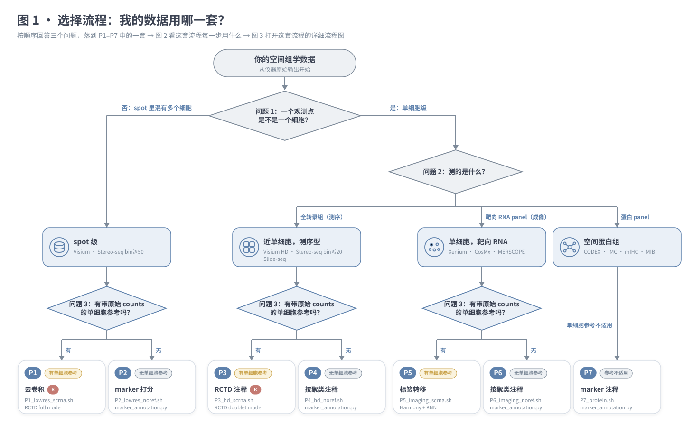
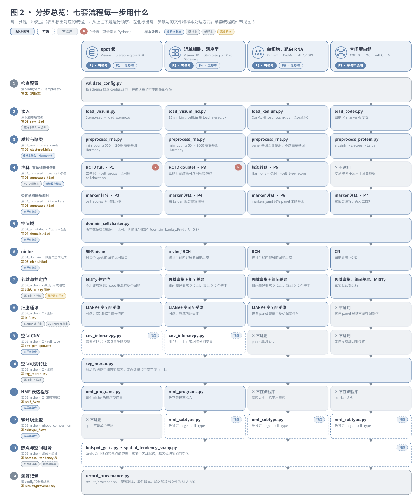
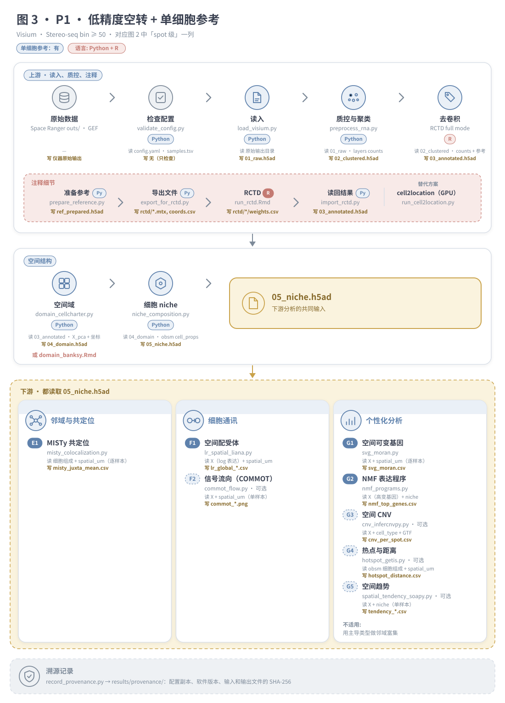
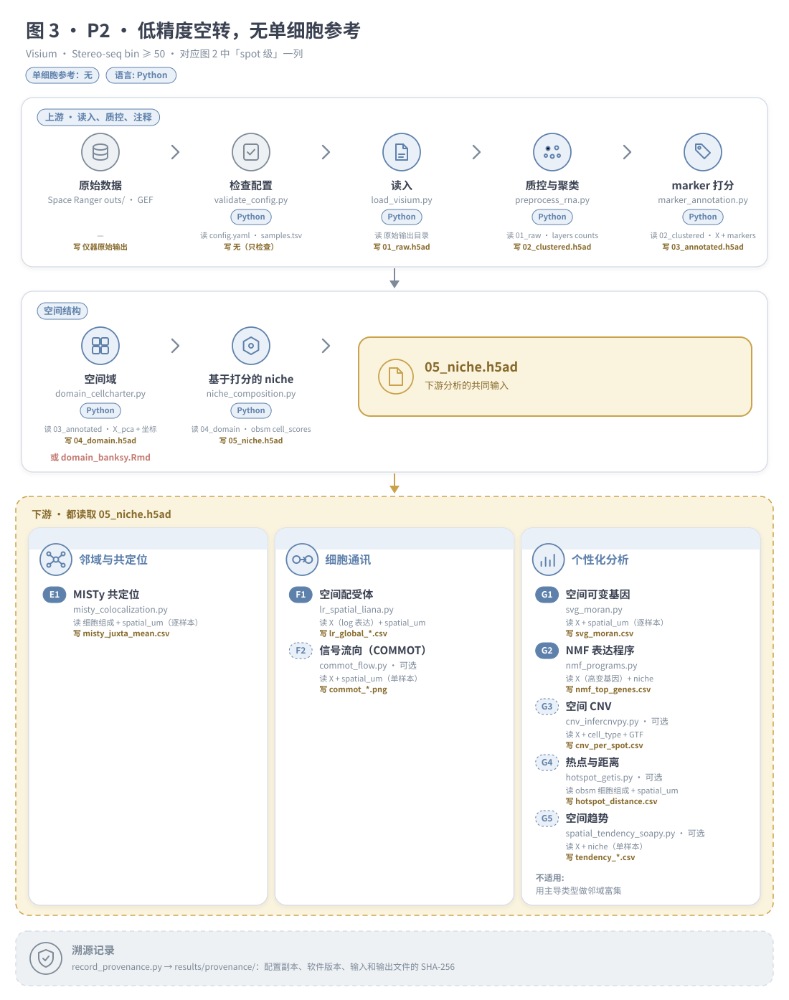
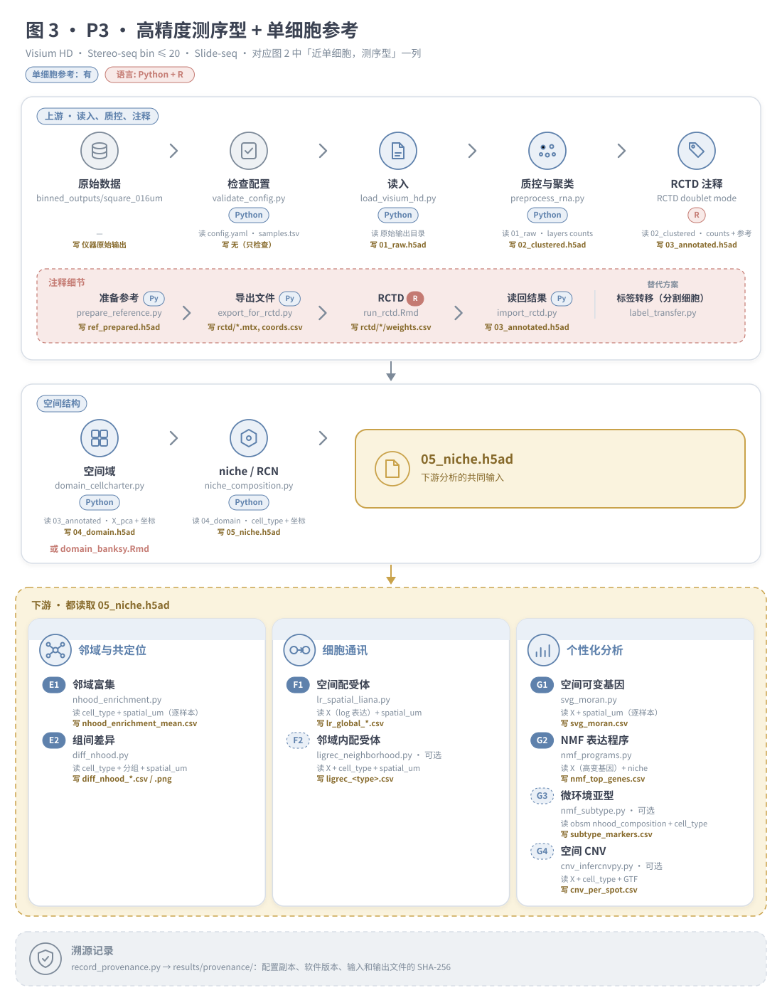
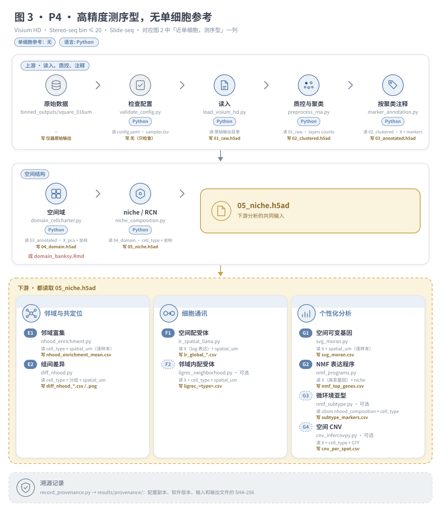
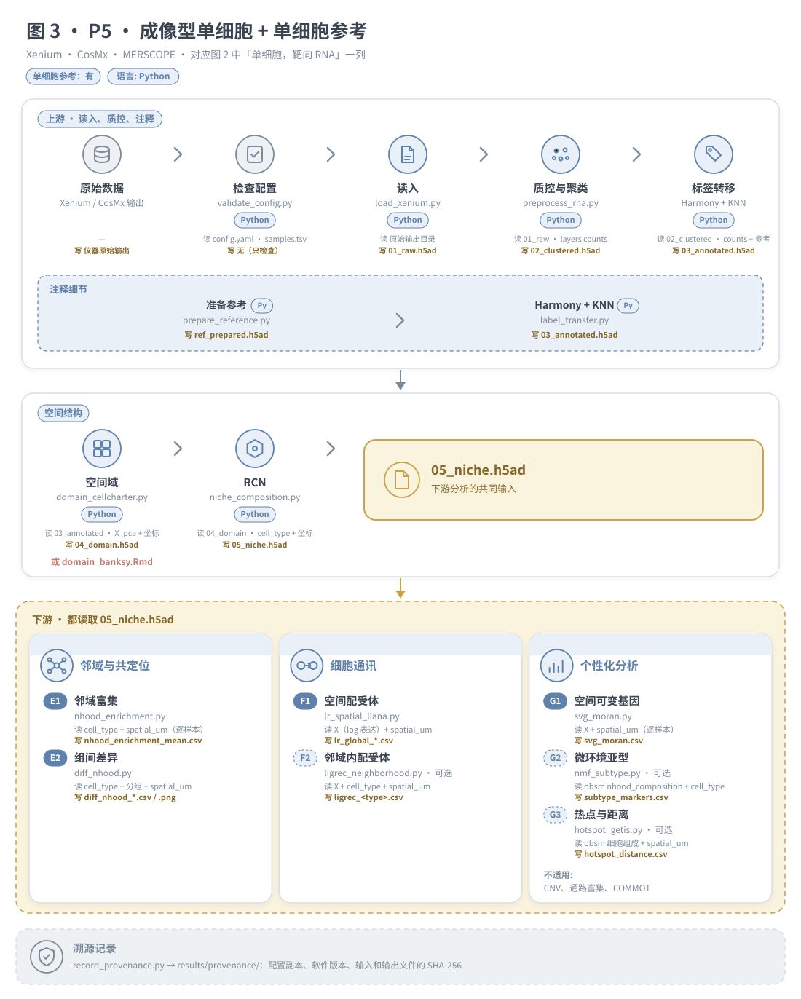
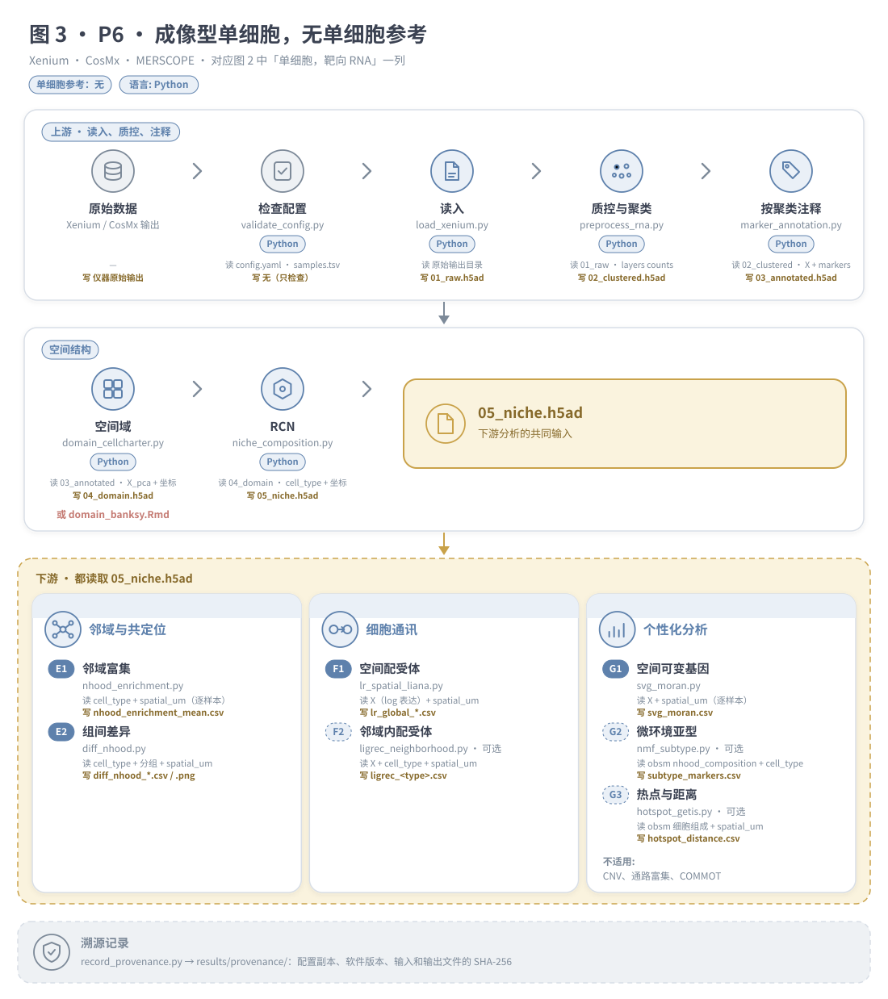
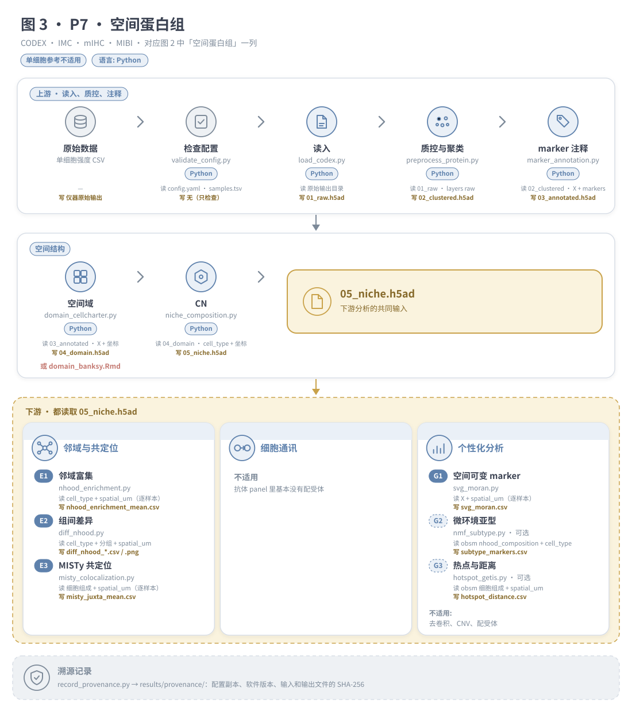
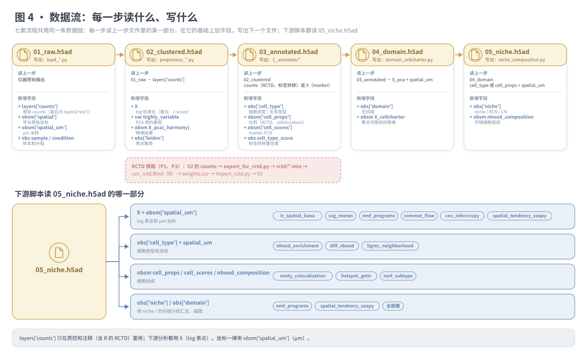

# spatial-downstream

**清晰、实用的空间转录组 / 空间蛋白组下游分析流程：每一步用什么方法、用 Python 还是 R、哪些分析能多样本联合、哪些只能单样本。**

[English README](README.md) · 版本 1.0.0 · 许可证：MIT · 语言：Python + R

关键词：空间转录组、空间蛋白组、Visium、Visium HD、Stereo-seq、Slide-seq、Xenium、CosMx、MERSCOPE、CODEX、IMC、去卷积、RCTD、cell2location、标签转移、空间域、BANKSY、CellCharter、细胞 niche、细胞邻域、邻域富集、MISTy、配体-受体、LIANA+、COMMOT、空间 CNV、scanpy、squidpy、FAIR。

---

## 1. 为什么做这个 skill

空间组学下游分析里，最常让人纠结的是两件事：

1. **工具太多，又分散在 R 和 Python 两边。** 同一个任务往往有好几个候选：去卷积用 RCTD 还是 cell2location？空间域用 BANKSY 还是 CellCharter？通讯用 squidpy、LIANA+、COMMOT 还是 CellChat？有的只有 R 版，有的只有 Python 版。到底哪个适合自己的平台、两种语言之间怎么传数据，都不清楚。
2. **不清楚哪些分析能多样本一起做。** 有的步骤可以把所有样本放进一个模型；有的只在一张切片内部才有意义。搞混了程序不会报错，但"邻居"会悄悄跨到别的样本上，结果是错的。

这个 skill 的目的，就是把这些整理成**清晰、能直接用的分析流程**：

- **每种情况一套流程**：按数据类型 × 有没有单细胞参考分成 P1–P7，用图 1 回答三个问题就能选出来；
- **每一步给出一个推荐方法，并写明用 Python 还是 R**：需要 R 的步骤都配好了经过测试的文件交换方式，不用在两个生态之间来回纠结；
- **每一步的输入和输出都写清楚**：图 2–4 标出每一步读上一步的哪部分数据、写出什么；
- **标明哪些分析能多样本联合、哪些只能单样本，并说明原因**：每一步都归入"多样本联合 / 逐样本计算 / 单样本 / 需要多样本"之一（见下文"多样本还是单样本？"）；
- **能运行、经过测试**：脚本短小易读，环境版本固定，每次运行留下溯源记录，并用各平台真实文件格式的模拟数据做了端到端测试。

技术上：每一步都是从上到下运行的短脚本（用 `# %%` 分块，可以在 Jupyter / VS Code 里逐块运行，也可以 `python 脚本.py` 直接运行）；步骤之间通过统一的 AnnData 数据约定交换数据；`SKILL.md` 告诉 Claude Code 助手如何选流程、如何按数据调整。

## 2. 选流程

文档里有三类图，从粗到细：

| 图 | 文件 | 回答什么问题 |
|---|---|---|
| **图 1** · 选择流程 | `docs/decision_zh.svg` | 我的数据用 P1–P7 中的哪一套？ |
| **图 2** · 分步总览 | `docs/steps_zh.svg` | 每种数据每一步用什么？（七套流程放在一张图里） |
| **图 3** · 单套流程详图 | `docs/P1_zh.svg` … `docs/P7_zh.svg` | 选定的这一套具体怎么跑、按什么顺序运行哪些脚本？每一步读什么、写什么？ |
| **图 4** · 数据流 | `docs/dataflow_zh.svg` | 每一步用上一步文件里的哪一部分、新增哪些字段？（所有流程通用） |

按这个顺序看：用图 1 选出流程，在图 2 找到它所在的那一列，再打开它的图 3 照着运行。图 4 说明串起各步骤的那些文件。

**图 1 · 选择流程**（从上往下依次回答三个问题）：



| 编号 | 数据类型 | 平台 | 单细胞参考 | 注释方法 | 语言 |
|---|---|---|---|---|---|
| **P1** `P1_lowres_scrna` | spot 级（一个点含多个细胞） | Visium、Stereo-seq bin ≥ 50 | 有 | RCTD full（或 cell2location） | Python + R（RCTD 这一步） |
| **P2** `P2_lowres_noref` | spot 级 | Visium、Stereo-seq bin ≥ 50 | 无 | marker 打分 | Python |
| **P3** `P3_hd_scrna` | 近单细胞，测序型 | Visium HD 8/16 µm、Stereo-seq bin ≤ 20 / cellbin、Slide-seq | 有 | RCTD doublet | Python + R（RCTD 这一步） |
| **P4** `P4_hd_noref` | 近单细胞，测序型 | 同 P3 | 无 | 按聚类 marker 打分 | Python |
| **P5** `P5_imaging_scrna` | 单细胞，靶向基因 panel | Xenium、CosMx、MERSCOPE | 有 | Harmony + KNN 标签转移 | Python |
| **P6** `P6_imaging_noref` | 单细胞，靶向基因 panel | 同 P5 | 无 | 按聚类 marker 打分 | Python |
| **P7** `P7_protein` | 单细胞，蛋白 panel | CODEX/PhenoCycler、IMC、mIHC、MIBI | 不适用 | marker 打分 + 人工核对 | Python |

按顺序回答三个问题：
1. 一个观测点是不是一个细胞？不是 → P1/P2；是 → P3–P7。
2. 是测序型全转录组（P3/P4）、靶向 RNA panel（P5/P6），还是蛋白（P7）？
3. 有没有配对或同组织、带原始 counts 的单细胞参考？有 → 奇数编号；没有 → 偶数编号。

各场景的细节和注意事项：[`references/decision_guide.md`](references/decision_guide.md)。

## 3. 每套流程跑哪些步骤

**图 2 · 分步总览：七套流程每一步用什么**（每一列是一种数据，每一行是一个步骤，按运行顺序从上往下；实线框 = 默认运行，虚线框 = 可选，灰色 = 不适用并写明原因，红色“R”标记 = R 步骤）：



同样的内容用表格列出：

| 模块 | 步骤（脚本） | P1 | P2 | P3 | P4 | P5 | P6 | P7 | 语言 |
|---|---|---|---|---|---|---|---|---|---|
| Z | `validate_config.py` 检查配置 | ● | ● | ● | ● | ● | ● | ● | Py |
| A | `load_visium` / `load_visium_hd` / `load_stereo` / `load_xenium` / `load_cosmx` / `load_codex` | ● | ● | ● | ● | ● | ● | ● | Py |
| B | `preprocess_rna.py`（P7 用 `preprocess_protein.py`） | ● | ● | ● | ● | ● | ● | ● | Py |
| C | `prepare_reference` → `export_for_rctd` → **`run_rctd.Rmd`** → `import_rctd` | ● | | ● | | | | | Py → **R** → Py |
| C | `label_transfer.py` | | | | | ● | | | Py |
| C | `marker_annotation.py` | | ● | | ● | | ● | ● | Py |
| D | `domain_cellcharter.py`（或 **`domain_banksy.Rmd`**） | ● | ● | ● | ● | ● | ● | ● | Py（或 R） |
| D | `niche_composition.py`（niche / RCN / CN） | ● | ● | ● | ● | ● | ● | ● | Py |
| E | `misty_colocalization.py` | ● | ● | | | | | ● | Py |
| E | `nhood_enrichment.py` | | | ● | ● | ● | ● | ● | Py |
| E | `diff_nhood.py`（≥ 2 组、每组 ≥ 2 个样本） | | | ● | ● | ● | ● | ● | Py |
| F | `lr_spatial_liana.py` | ● | ● | ● | ● | ● | ● | | Py |
| F | `ligrec_neighborhood.py`、`commot_flow.py` | 可选 | 可选 | 可选 | 可选 | 可选 | 可选 | | Py |
| G | `svg_moran.py` | ● | ● | ● | ● | ● | ● | ● | Py |
| G | `nmf_programs.py` | ● | ● | ● | ● | | | | Py |
| G | `cnv_infercnvpy.py`、`hotspot_getis.py`、`nmf_subtype.py`、`spatial_tendency_soapy.py` | 可选 | 可选 | 可选 | 可选 | 可选 | 可选 | 可选 | Py |
| Z | `record_provenance.py` 记录溯源 | ● | ● | ● | ● | ● | ● | ● | Py |

● 默认运行；可选 = 在流程脚本里被注释掉，设好参数后取消注释即可。

### 图 3 · 单套流程详图

点开每套流程查看它的详细流程图（每张对应图 2 中的一列）。每个步骤下方，“读”是它用的上一步文件里的哪一部分，“写”是它写出的文件。实心编号的步骤默认运行，虚线编号的是可选步骤；颜色含义：蓝 = Python 步骤，红 = R 步骤，黄 = 关键输出 / 有单细胞参考，灰 = 中性（配置、溯源、不适用）。用 `python docs/make_figures.py` 可以重新生成这些图。

<details><summary><b>P1</b> · 低精度 + 单细胞参考</summary>



</details>

<details><summary><b>P2</b> · 低精度，无参考</summary>



</details>

<details><summary><b>P3</b> · 高精度测序型 + 参考</summary>



</details>

<details><summary><b>P4</b> · 高精度测序型，无参考</summary>



</details>

<details><summary><b>P5</b> · 成像型单细胞 + 参考</summary>



</details>

<details><summary><b>P6</b> · 成像型单细胞，无参考</summary>



</details>

<details><summary><b>P7</b> · 空间蛋白组</summary>



</details>

### 图 4 · 数据流

每一步读上一步 h5ad 文件里的某一部分，写出下一个文件；下游脚本都读 `05_niche.h5ad`。字段定义见 [`schemas/anndata_contract.md`](schemas/anndata_contract.md)。



### 多样本还是单样本？

对照课程演示代码的写法，判断标准是：**只用表达的步骤可以多样本联合**（用 Harmony 处理批次）；**用到坐标的步骤，"邻居"必须来自同一张切片**；**要和随机比较的统计量（置换检验、Moran's I）逐样本计算再汇总**，因为合在一起算会把样本间的差异混进去。把所有样本写进同一个 `samples.tsv`，整套流程跑一次即可。每一课的演示代码怎么处理样本、为什么这样分类，见 [`references/multi_sample.md`](references/multi_sample.md)。

| 处理方式 | 步骤 | 原因 |
|---|---|---|
| **多样本联合**（一个模型，聚类 / niche / 空间域编号跨样本可比） | 质控与聚类（Harmony）、cell2location、标签转移、marker 注释、CNV、空间域（CellCharter / BANKSY）、niche / RCN / CN、邻域内配受体、NMF 程序、微环境亚型 | 只用表达的步骤直接合并；用坐标的步骤先按样本建邻居图，再联合聚类，niche 和空间域的编号才可比（课程 RCN 一课正是按 FOV 统计邻域、再一起聚类） |
| **逐样本计算，再汇总**（脚本自动循环，各样本结果也单独保存） | RCTD、邻域富集（平均 z + 几个样本方向一致）、MISTy（平均重要性）、空间可变基因（平均 Moran's I + 在几个样本里显著）、共现、LIANA+ 空间配受体、热点与距离 | 统计量只在一张切片内有意义，或者合在一起算会把样本间差异混进去。实测：一个只有批次差异、没有空间模式的基因，合并计算 Moran's I = 0.19，逐样本计算约为 0 |
| **单样本**（改脚本顶部的 `sample` 逐个运行） | COMMOT 信号流向、空间趋势（SOAPy） | 最优传输和区域掩膜只在一张切片内有意义 |
| **需要多样本** | 组间邻域差异（`diff_nhood.py`）；用 `niche_composition_by_sample.csv` 做样本水平的检验 | 以样本为重复单位：至少 2 组 × 每组 2 个样本（≥ 3 个更可靠） |

## 4. 快速开始

### 安装 skill（Claude Code 和 Codex 都可以）

这个 skill 就是一个顶层带 `SKILL.md` 的普通文件夹，Claude Code 和 OpenAI Codex 都能用。从 GitHub 直接下载到所用工具的 skills 目录（需要 `git`）：

```bash
# Claude Code（所有项目可用）
git clone https://github.com/alexpengyl1/spatial-downstream.git ~/.claude/skills/spatial-downstream

# Codex
git clone https://github.com/alexpengyl1/spatial-downstream.git ~/.codex/skills/spatial-downstream
```

只想在某个项目里用 Claude Code 时，改成克隆到 `<项目>/.claude/skills/spatial-downstream`。没有 `git` 的话，在 GitHub 页面点 **Code → Download ZIP**，解压后把文件夹改名为 `spatial-downstream`，放进上面的 skills 目录。以后更新：`git -C ~/.claude/skills/spatial-downstream pull`。

只想保留一份时，装到其中一个，再链接到另一个，例如 `ln -s ~/.claude/skills/spatial-downstream ~/.codex/skills/spatial-downstream`。装好后重启工具，它会根据 `SKILL.md` 里的 `name` 和 `description` 识别这个 skill；之后直接说"用单细胞参考分析我的 Visium 数据"之类即可。

流程脚本根据自身位置找到其他脚本，所以装在哪个目录都能运行。只有在流程之外单独运行 `validate_config` / `record_provenance`（脚本或笔记本），并且装的位置不是 `~/.claude/skills/spatial-downstream` 时，才需要把 `SPATIAL_SKILL_DIR` 设成安装目录。

### 运行流程

```bash
SKILL_DIR=~/.claude/skills/spatial-downstream      # Codex：~/.codex/skills/spatial-downstream

# 1. 建环境（只需一次）
conda env create -f "$SKILL_DIR"/envs/spatial-py.yml
Rscript "$SKILL_DIR"/envs/install_r_packages.R      # 只有 P1 / P3 / BANKSY 需要

# 2. 建项目目录
mkdir my_project && cd my_project
cp "$SKILL_DIR"/assets/configs/P1_lowres_scrna.yaml config.yaml
cp "$SKILL_DIR"/assets/samples_template.tsv samples.tsv
cp "$SKILL_DIR"/assets/markers_template.yaml markers.yaml
#    修改 config.yaml（物种、参考路径、半径等）和 samples.tsv（sample、condition、path）

# 3. 运行
bash "$SKILL_DIR"/pipelines/P1_lowres_scrna.sh
```

`samples.tsv` 有三列，用制表符分隔：`sample`、`condition`、`path`（Space Ranger 的 `outs/` 目录、Xenium 输出目录、CosMx 目录，或 CODEX 的 CSV 文件）。

每个阶段都会在 `results/` 里写一个 h5ad，所以可以从任意阶段重新开始，手动运行后面的脚本即可。

### 交互式使用：JupyterLab 笔记本和 R Markdown 报告

- **Python**：`scripts/` 里的每个脚本，在 `notebooks/` 下都有一个代码相同的 JupyterLab 笔记本（目录结构一样）。笔记本开头是说明，然后是设置 `project_dir` 的格子；每个代码格都以"步骤 / 输入 / 输出"三行注释开头，格子后面用一句话说明这一步得到了什么。流程运行的是 `.py`；改了 `.py` 之后运行 `python tools/make_notebooks.py` 重新生成笔记本，两边永远一致。
- **R**：R 步骤都是 R Markdown 报告（`run_rctd.Rmd`、`domain_banksy.Rmd`、`seurat_to_mtx.Rmd`）：编号小节、浮动目录、默认显示代码、每段代码前有说明、有检查用的表格、最后是 `sessionInfo()`。可以在 RStudio 里 Knit（在 YAML 的 `params` 里设 `project_dir`），也可以由流程自动渲染，HTML 报告写到 `results/reports/`。渲染需要 pandoc，RStudio 和 Quarto 都自带；命令行找不到时设置 `RSTUDIO_PANDOC`。

## 5. 目录结构

```
spatial-downstream/
├── README.md、README.zh-CN.md   说明文档（英文 / 中文）
├── SKILL.md                     给 Claude Code 助手的说明
├── VERSION、CHANGELOG.md        版本号和更新记录
├── CITATION.cff、codemeta.json  引用信息和机器可读元数据
├── LICENSE                      MIT 许可证
├── pipelines/                   P1–P7 流程脚本（bash）
├── notebooks/                   JupyterLab 笔记本，每个 Python 脚本一个（自动生成）
├── tools/                       make_notebooks.py：从脚本重新生成笔记本
├── scripts/
│   ├── A_load/                  各平台读入 → 01_raw.h5ad
│   ├── B_preprocess/            质控、标准化、Harmony、Leiden → 02_clustered.h5ad
│   ├── C_annotate/              RCTD、cell2location、标签转移、marker → 03_annotated.h5ad
│   ├── D_domain_niche/          空间域、niche → 04_domain.h5ad、05_niche.h5ad
│   ├── E_neighborhood/          邻域富集、组间差异、MISTy
│   ├── F_communication/         配体-受体分析
│   ├── G_special/               CNV、SVG、热点、NMF、亚型、空间趋势
│   ├── bridge/                  R ↔ Python 数据交换
│   └── Z_provenance/            配置检查、溯源记录
├── docs/                        流程图（SVG）和生成脚本 make_figures.py
├── assets/                      配置预设（configs/P*.yaml）、模板
├── schemas/                     配置的 JSON Schema、AnnData 数据约定
├── envs/                        固定版本的 Python 环境、R 安装脚本、测试过的版本表
├── references/                  选路线指南、方法适用表、多样本说明、单位、R–Python 联合、脚本对照
└── tests/                       模拟数据生成器和端到端测试
```

## 6. R 和 Python 怎么联合

主线对象始终是 h5ad。需要 R 的步骤（RCTD、BANKSY、基于 Seurat 的工具）：Python 导出普通文件，R 运行后返回以条形码为键的 CSV，Python 再按条形码合并回去：

```
h5ad ──导出（counts.mtx 基因×细胞、genes.txt、barcodes.txt、obs.csv、coords.csv）──▶ R ──result.csv──▶ 按条形码合并 ──▶ h5ad
```

原则：只交换原始整数 counts；两边基因名一致；坐标用 µm；一律按条形码合并，不按行号。完整说明见 [`references/r_python_bridge.md`](references/r_python_bridge.md)。

## 7. 必须遵守的约定

- **单位**：所有半径和距离都用 `obsm['spatial_um']`（µm）。读入脚本负责把像素、DNB 等平台单位换算成 µm。见 [`references/units_and_params.md`](references/units_and_params.md)。
- **多样本**：邻居一律不跨样本：要么按样本建邻居图（`library_key="sample"`），要么先把各样本坐标错开（MISTy、BANKSY），要么按样本循环。见 [`references/multi_sample.md`](references/multi_sample.md)。
- **保留原始数据**：`layers['counts']`（RNA）或 `layers['raw']`（蛋白）始终不覆盖；h5ad 保留全部基因。
- **spot 数据**：用细胞类型比例做 niche 和 MISTy，不用主导类型做邻域富集。
- **靶向 panel**：不做 CNV、通路富集、RNA 速度；做配受体之前先查覆盖率。
- **macOS / Windows**：spawn 方式开子进程时会重新执行整个脚本，所以脚本避开了这类进程池（squidpy 关闭进度条；CNV 脚本设置 fork）。

## 8. 测试

```bash
bash "$SKILL_DIR"/tests/run_tests.sh /path/to/work_dir
```

`tests/make_test_data.py` 按各平台真实的文件格式生成小型模拟数据（Space Ranger HDF5 + spatial 目录、Visium HD 的 binned parquet、Xenium HDF5 + parquet、CosMx CSV、CODEX CSV），外加一份单细胞参考；然后把 P1–P7 从头到尾跑一遍，逐个打印 PASS / FAIL。

**已测试**：7 套流程在模拟数据上全部跑通（macOS arm64，版本见 [`envs/tested_versions.tsv`](envs/tested_versions.tsv)）；Visium、Visium HD、Xenium、CosMx、CODEX 格式的读入；RCTD full 和 doublet 模式；BANKSY 的 R 往返。
**尚未测试**：真实仪器数据、`load_stereo.py`（stereopy）、`run_cell2location.py`、`commot_flow.py`、`spatial_tendency_soapy.py`、Linux 和 Windows。

## 9. FAIR 说明

| 原则 | 本项目的做法 |
|---|---|
| **F** 可查找 | `README`、`CITATION.cff`、`codemeta.json` 里有描述性名称、关键词和版本号；语义化版本（`VERSION`、`CHANGELOG.md`）。把带标签的版本存档到 Zenodo 即可获得永久标识符（DOI，见第 10 节）。 |
| **A** 可获取 | 脚本和文档都是纯文本；MIT 开放许可（任何用途都免费，包括商用）；只依赖可从 PyPI / CRAN / Bioconductor 安装的开源软件；不需要登录或商业软件。 |
| **I** 可互操作 | 只用社区标准格式：AnnData `.h5ad`、Matrix Market `.mtx`、CSV/TSV、YAML、JSON Schema。有成文的数据约定（[`schemas/anndata_contract.md`](schemas/anndata_contract.md)）和可校验的配置（[`schemas/config.schema.json`](schemas/config.schema.json)）；基因用 HGNC/MGI symbol，可选 Cell Ontology ID；坐标用国际单位（µm）。 |
| **R** 可重用 | 许可证和引用信息明确；环境版本固定并经过测试；每次运行都会写 `results/provenance/`（配置副本、软件版本、R sessionInfo、输入和输出文件的 SHA-256 校验值）；有基于模拟数据的端到端测试；每个脚本开头写清输入、输出和参数。 |

## 10. 引用和许可证

引用本项目请使用 [`CITATION.cff`](CITATION.cff) 中的信息，同时引用你用到的方法：

| 步骤 | 方法 |
|---|---|
| 预处理 | Scanpy（Wolf et al., *Genome Biol* 2018）；Harmony（Korsunsky et al., *Nat Methods* 2019） |
| 空间统计 | Squidpy（Palla et al., *Nat Methods* 2022） |
| 去卷积 | RCTD（Cable et al., *Nat Biotechnol* 2022）；cell2location（Kleshchevnikov et al., *Nat Biotechnol* 2022） |
| 空间域 | BANKSY（Singhal et al., *Nat Genet* 2024）；CellCharter（Varrone et al., *Nat Genet* 2024） |
| 共定位、配受体 | MISTy（Tanevski et al., *Genome Biol* 2022）；LIANA+（Dimitrov et al., *Nat Cell Biol* 2024）；CellPhoneDB（Efremova et al., *Nat Protoc* 2020）；COMMOT（Cang et al., *Nat Methods* 2023） |
| CNV | inferCNV（Tirosh et al., *Science* 2016）/ infercnvpy |
| 热点 | Getis & Ord（1992），PySAL `esda` |
| 空间趋势 | SOAPy |

获取 DOI：把仓库推到 GitHub，打开 Zenodo 集成，发布标签为 `v1.0.0` 的版本；然后把 DOI 填回 `CITATION.cff` 和 `codemeta.json`。

许可证：[MIT](LICENSE)。版权所有 © 2026 Yueling Peng。任何人都可以免费使用、复制、修改、再分发，包括商用；唯一的条件是保留版权和许可声明。

